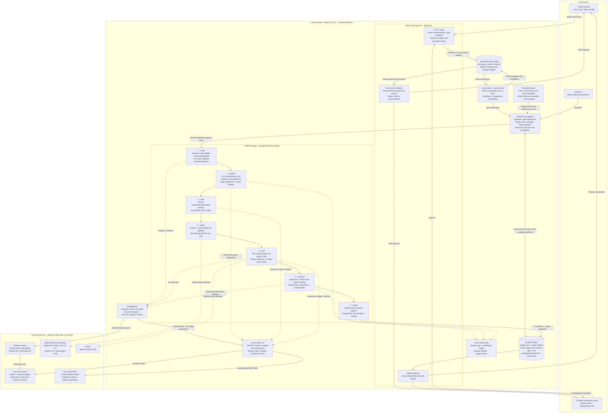

# Podframes

Turn a topic into a two-host podcast video: local Codex writes the script and generates images, Fish Audio supplies voices using website credits, local Whisper supplies word timestamps, and HyperFrames renders the finished MP4.

The existing Podframes studio flow and visual design stay intact. Choose **P-Video Avatar**, **LTX-2.3**, or **HeyGen** for per-turn lip-sync.

For installation, automation, service readiness, and operational guides, see the [documentation index](docs/README.md).

## Setup

For colleagues sharing this host, see [private team access](docs/TEAM.md). Owners approve members; editors generate with shared credits.

For a production URL on your server, follow [production hosting](docs/PRODUCTION.md), or invoke `$podframes-deploy` in this checkout.

For a repeatable Ubuntu 24.04 VM or macOS installation, follow the **[complete setup guide](docs/SETUP.md)**. Run `bash scripts/setup.sh` from a checkout to install dependencies and build; finish account logins, run `pnpm podframes doctor` and `bash scripts/run-service.sh check`, then use `bash scripts/setup.sh services` for background web/worker services. Both processes run on the same machine.

Requires Node 22+, pnpm, ffmpeg/ffprobe, the local Codex CLI, and whisper.cpp with a multilingual model.

```sh
pnpm install
codex login
codex mcp add fish-audio --url https://api.fish.audio/mcp
codex mcp login fish-audio
```

Sign in to Codex with your ChatGPT account and to Fish Audio in the browser. Fish speech uses your **website credits**, including the free-plan allowance. `FISH_API_KEY` and developer API credit are not used.

For measured caption timing, install local Whisper (macOS):

```sh
brew install whisper-cpp
mkdir -p ~/.cache/podframes
curl -fL https://huggingface.co/ggerganov/whisper.cpp/resolve/main/ggml-base.bin -o ~/.cache/podframes/ggml-base.bin
```

Other platforms can build [whisper.cpp](https://github.com/ggml-org/whisper.cpp). Set `WHISPER_MODEL` if your model is stored elsewhere.

Choose a video provider. API credentials can go in the project root’s `.env.local` or `.env`:

- `REPLICATE_API_KEY`: P-Video Avatar, the default.
- `FAL_API_KEY`: LTX-2.3.
- HeyGen subscription login or `HEYGEN_API_KEY`: HeyGen.

```sh
pnpm podframes doctor
pnpm dev:web
# In a second terminal, start the generation worker:
pnpm worker
# Open http://localhost:3000/studio
```

Run this app locally on the machine with the Codex and HeyGen sessions. A remotely hosted server cannot access your computer's local sessions.

## Pipeline

For the complete first-episode walkthrough, recurring automation commands, script format, character/image reuse, and failure recovery, see the [podcast automation guide](docs/AUTOMATION.md).

For n8n, import the [seven-stage workflow](examples/n8n/podframes-seven-stages.json) and follow the [n8n setup guide](docs/N8N.md). It orchestrates the same backend stages, checks completion, supports existing-project resume, and downloads the final MP4.

In Studio’s **Script** step, use **Generate full video** for a topic, or **Paste or import a script → Import & generate full video** for external dialogue. Both run through speech, avatars, lip-sync, B-roll, captions, and the final MP4 without stepping through each screen. The selected provider must already be authenticated; generation uses its credits. Completed stages are reused when you resume.

Plain `.txt` is the simplest interchange format; `.md` accepts the same speaker-labelled dialogue, an optional `# Title`, and bold speaker labels. Use your cast names or `HOST_A` / `HOST_B`. Continuation lines belong to the preceding speaker. Fish delivery tags remain intact. Imports preserve wording and do not automatically fact-check claims.

```text
# Episode title
HOST_A: [curious] What happened?
HOST_B: Let’s walk through the evidence.
```

For local automation, save that text as `episode.md` and run from the repository root:

```sh
pnpm podframes generate --script episode.md --slug my-episode --provider heygen --heygen-auth subscription --language zh --aspect 9:16
```

Use your script’s language and desired provider. The final file is `projects/my-episode/output.mp4`. Re-run the same command to resume completed work; changing the imported dialogue invalidates downstream audio/video. `--only script` imports and validates without calling generation services.

For recurring episodes, use `--template <existing-project-slug>`. It inherits the show's hosts, Fish voices, language, framing, video provider, and edit settings. Saved host portraits are copied exactly into the new episode, including generated characters. Existing B-roll images become a reusable library; the planner can select relevant images with fresh timing. Old dialogue, audio, and lip-sync clips are not copied. Source images are copied into independent files, so changing/deleting the template does not change the episode. The template must have both saved host portraits and its referenced image files. Use a different slug for every new episode.

In the interface, open **Studio → Your videos → Use as template** on the source project's card. The new episode opens in **Cast & voice** with the copied faces and voices. Review them, proceed to **Script**, paste/import the new dialogue, and choose **Import & generate full video**. To choose a different individual face, click its portrait in **Cast & voice**. The source project is kept intact, and old episode reference links are not carried over.

This sample uses your existing show and the included Mandarin script:

```sh
pnpm podframes generate --template what-makes-a-good-cold-open-episode --script examples/automation/episode.md --slug podcast-episode-002 --provider heygen --heygen-auth subscription --language zh
```

An external research/writing agent can save a new Markdown file and run that command locally, using a new episode slug each time. The result is `projects/podcast-episode-002/output.mp4`. The command runs one episode and exits; it does not install a schedule or folder watcher.

1. **Script:** a fresh local `codex exec` task returns structured two-host dialogue.
2. **Speech:** Fish Audio MCP synthesizes each turn using website credits. Local Whisper transcribes that exact audio for measured word timestamps. ffmpeg assembles the master audio and inter-turn pauses.
3. **Avatars:** keep a roster face, upload a photo, or choose **Generate portrait** in the face picker. Generated portraits use Codex's built-in image tool.
4. **Animation:** P-Video, LTX, or HeyGen animates each portrait against the turn's actual audio.
5. **B-roll:** Codex chooses timed supporting visuals, stat cards, quotes, and lower-thirds. Use **Upload photo** on an image cue for real photography or screenshots (PNG/JPEG/WebP, up to 10 MB), or **Generate AI** for a candid documentary-style illustration. Uploads retain the cue's timing and camera motion; re-rendering reuses them. Re-suggesting replaces the cue list, including uploaded photos. This stage does not generate video footage.
6. **Compose/render:** HyperFrames assembles the clips, audio, captions, and supporting visuals into MP4.

Codex uses your existing ChatGPT login, with an isolated temporary workspace per request. API-key environment variables are removed from its subprocess environment. There is no automatic fallback to paid OpenAI API generation. Built-in image availability and subscription limits apply; unsupported sessions fail clearly.

## Technical architecture

Studio and the automation API enqueue full pipeline runs for a separate local worker. The CLI calls the same core pipeline directly. The web server and worker share this repository's filesystem; the cloud deployment described in the [deployment proposal](docs/DEPLOYMENT.md) is not the current runtime.



Solid arrows show execution, delivery, or persistence; dotted arrows show stage dependencies. Shared services and storage appear once. The stage chain is execution order: each stage also reads the earlier artifacts it needs from project state. Within speech and video, bounded worker pools process turns or segments concurrently.

### Execution and artifact contracts

| Boundary | Technical behavior | Implementation |
| --- | --- | --- |
| HTTP admission | Authenticates the owner, validates requests, applies generation limits, and records idempotent versioned POST responses. Full pipeline requests return after queueing; they do not keep an HTTP request open for the render. Preview and editing actions have their own routes. | [API contract](docs/API.md), [run admission](apps/web/lib/runs.ts), [versioned routes](apps/web/app/api/v1/\[...path\]/route.ts) |
| Queue and worker | SQLite transactions coordinate web and worker processes. The worker claims one pipeline job at a time, persists progress, and checks cancellation between stages and inside worker pools. CLI runs bypass the HTTP queue and request budget, but share project locks. | [Queue](packages/core/src/automation.ts), [durable storage](packages/core/src/util/durable.ts), [worker](scripts/worker.mts), [CLI](apps/cli/src/index.ts) |
| Pipeline coordinator | Validates config, loads environment, checks required tools and credentials before stage execution, selects `from` / `to` / `only`, and saves running/done/error state. Completed stages with recorded artifacts are skipped on ordinary resumes. | [Pipeline](packages/core/src/pipeline.ts), [project state](packages/core/src/project.ts), [locks](packages/core/src/util/lock.ts) |
| Dialogue | Topic drafting uses the selected writer, script examples, and live research. Structured results must pass schema and source-evidence checks. Imported speaker-labelled text bypasses drafting; delivery direction preserves spoken dialogue. | [Script stage](packages/core/src/stages/script.ts), [writer adapter](packages/core/src/clients/writing.ts), [import parser](packages/core/src/script-import.ts), [delivery](packages/core/src/delivery.ts) |
| Speech and timing | Fish returns purchased audio; its URL is cached before download/alignment. Local Whisper measures word timestamps against that audio. ffmpeg splits segments, inserts turn pauses, and assembles master audio; timing feeds captions and subsequent animation. | [Speech stage](packages/core/src/stages/speech.ts), [Fish client](packages/core/src/clients/fish.ts), [Whisper client](packages/core/src/clients/whisper.ts) |
| Portraits and animation | Portraits are reused or generated once per host. Each animation unit pairs the host portrait with its actual speech segment. The selected provider returns a downloaded clip; HeyGen remote job IDs persist for interrupted-job recovery. | [Stills](packages/core/src/stages/stills.ts), [video dispatch and pools](packages/core/src/stages/video.ts), [HeyGen client](packages/core/src/clients/heygen.ts) |
| Supporting visuals | Plans timed B-roll, statistics, quotes, and lower-thirds from the dialogue/timeline. Images can come from Codex, saved episode assets, or uploads; stock footage can come from Pexels. Uploaded/direct-link footage is supported through editing routes. The default AI-image path does not generate video footage. | [B-roll stage](packages/core/src/stages/broll.ts), [stock client](packages/core/src/clients/pexels.ts), [footage handling](packages/core/src/clients/footage.ts) |
| Composition and export | Trims audio/video consistently, remaps cue timing, groups word captions, and links media/fonts into an HTML composition. HyperFrames captures the browser composition with one render worker; ffmpeg removes the empty leading MP4 edit, optionally downscales, and produces `output.mp4`. | [Compose](packages/core/src/stages/compose.ts), [HTML builder](packages/core/src/compose/builder.ts), [render](packages/core/src/stages/render.ts) |

### Resume, edits, and billing boundaries

`projects/<slug>/project.json` is the episode's resume source of truth; media and per-turn/provider caches live beside it. The queue database tracks jobs and request receipts separately. Cross-process project locks and optimistic save checks prevent CLI, worker, and editing routes from silently overwriting the same episode.

Edits invalidate their dependent outputs through the [shared invalidation rules](packages/core/src/shared.ts) and [editing helpers](packages/core/src/editing.ts). For example, changed imported dialogue clears speech, video, B-roll, composition, and render while retaining host portraits. Presentation-only changes can reuse generated media and rebuild composition/render. `force` deliberately clears selected stage caches. A [show template](packages/core/src/show-template.ts) copies reusable portraits and images into independent episode files rather than inheriting old audio or lip-sync clips.

Writing can use an explicitly selected subscription or API connection; images and Fish website-credit speech still require local Codex. Subscription subprocesses strip API credentials from their environment. Provider/billing modes do not silently switch after failures. Uncertain Fish calls are not automatically repeated, and interrupted or failed worker jobs require review and explicit acknowledgement before retrying. Cancellation stops further cooperative work; it cannot refund completed remote generation. See [authentication, limits, and recovery](docs/API.md) and the [episode automation guide](docs/AUTOMATION.md).

## Language

Choose **Language** in **Cast & voice** before generating. English is the default; the picker includes Malay, Mandarin Chinese, Tamil, Indonesian, Japanese, Korean, Spanish, French, German, Hindi, Arabic, Thai, and Vietnamese. The selection is saved with the studio draft and used for new script dialogue, default voice-preview text, Fish speech, Whisper decoding, and b-roll labels. An existing script keeps its text until you click **rewrite**. Voice accent and delivery still depend on the chosen Fish voice.

## Drafting, sources, length, and delivery

The editable [scripting reference library](examples/script-library/README.md) supplies original conversational examples to topic drafting and **Auto-direct delivery**. It teaches rhythm, reactions, corrections, and restrained delivery through short reference excerpts; it does not train the model or replace current source checks. Edit the `zh-` examples for Mandarin. New requests read the current files automatically.

The Script step checks live web sources before writing. It uses the current UTC date to distinguish recent updates from historical incidents, opens relevant reporting, and saves source links and publication dates with the draft. Paste up to five public HTTPS reference links to steer the research. Expand **Sources checked** to review the evidence. Completed live-search and page-retrieval events are required, and each cited URL must match a page actually opened. A response that skips research or cites an unopened link is rejected. Redirects to generic indexes or login pages are not treated as evidence for an article headline.

Set **Target length (seconds)** from 15 to 600 seconds. This controls an approximate speech budget and turn count, rather than promising an exact final duration. Current audio length appears after synthesis.

**Context-aware delivery cues** directs new dialogue using the whole exchange, each host's persona/default style, and the intent of individual lines. It uses short free-form Fish directions for pace, emphasis, and restrained reactions, including inline changes when useful. There is no fixed tag quota or required list of emotions, and each turn gets at most two cues. An explicit leading per-line cue overrides the host's default style.

For an existing or imported script, click **Auto-direct delivery** in the Script step. This makes a Codex delivery-only proposal: spoken words, punctuation, numbers, speaker assignments, turn order, and source metadata are preserved. A result that changes the dialogue is rejected. Review the cues in the editor, adjust the new custom-delivery input if needed, then re-voice to hear them. The editor saves cue changes like other text edits; affected audio/video becomes stale, while new Fish generation starts only when requested. Direction suggestions alone do not synthesize speech. Audio quality still needs a listening check with the chosen voice.

Codex uses `gpt-6.1-sol` by default. If it reports capacity before any speech-generation tool starts, the app tries `gpt-6-sol` once. It does not automatically repeat an uncertain Fish generation. Set `PODFRAMES_CODEX_MODEL` in the root `.env` or `.env.local` to use another model available to your Codex subscription, then restart the app.

## Fish Audio voices

The studio includes public reference voices from [Fish's quickstart](https://docs.fish.audio/developer-guide/getting-started/quickstart). Paste a different Fish voice reference ID in the cast editor to use your own voice. The default model is `fish/drama-3`.

Voice previews and full turns use the official [Fish MCP connection](https://docs.fish.audio/overview/mcp), authenticated through Codex OAuth. Each request checks website credit and text limits. The free plan currently limits a speech call to 500 UTF-8 bytes; Chinese characters usually use three bytes each. Advanced developer API tuning options are not supported in website-credit mode.

Fish MCP transcription returns plain text without timestamps, so captions and segment timing are measured locally with Whisper. Missing or malformed timestamps fail the turn instead of fabricating timing. Generated audio URLs are cached per turn before download and alignment, so retries can reuse speech already bought. Uncertain MCP generation failures are not automatically retried, to avoid duplicate charges.

The local speech subprocess exposes only Fish credit balance and speech generation tools. It approves the requested speech tool within that subprocess; it does not grant other Fish tools access or change global tool-approval preferences.

## HeyGen subscription or API

Install the [official HeyGen CLI](https://github.com/heygen-com/heygen-cli#install), then choose a billing source:

```sh
# Subscription credits: complete browser login yourself.
heygen auth login --oauth
heygen auth status

# Or API credits: add HEYGEN_API_KEY to .env.local.
```

In the studio's **Generate videos** step, select **HeyGen**, then **Subscription** or **API credits**. API mode requires `HEYGEN_API_KEY`. Subscription mode removes the API key from the child environment and requires the CLI's stored OAuth credential. The app never changes your stored login. The CLI stores only one credential type; OAuth login replaces a stored API credential, and vice versa.

Each image and audio segment is uploaded through `heygen asset create`. Remote video IDs are saved beside the clip, so interrupted generation resumes the same job. Explicit clip regeneration creates a fresh request. If a creation request has an unknown outcome for over 24 hours, the app requires reconciliation with `heygen video list` rather than risking a duplicate purchase.

## CLI

```sh
pnpm podframes generate --topic "Why is the sky blue?" --turns 10
pnpm podframes generate --topic "AI agents" --only script,speech
pnpm podframes generate --topic "Coffee" --provider fal-ltx
pnpm podframes generate --topic "Coffee" --provider heygen --heygen-auth subscription
pnpm podframes generate --topic "Coffee" --provider heygen --heygen-auth api
pnpm podframes --help
```

Projects remain under `projects/<slug>/`. Existing completed media is retained. For older Speechbase projects, choose Fish Audio and valid Fish reference IDs for both hosts before regenerating speech; old provider voice IDs are not interchangeable.

## Codex skill installation and use

The producer skill is included in the checkout at [`.agents/skills/podframes-producer/SKILL.md`](.agents/skills/podframes-producer/SKILL.md). Load it from the Podframes project:

1. Open the `podframes` repository folder as your project in Codex.
2. Start a new chat in that project so repository skills can be discovered.
3. Type `$podframes-producer` followed by your request. Select the skill from the skill picker when available.
4. Follow the brief questions, review the scripts and generation settings, and approve the specific episode or batch before paid media generation.

If the skill is absent from the picker, verify that the file exists in your checkout and reopen the Podframes project in a fresh chat. For a session that already has file access, explicitly ask it to read `.agents/skills/podframes-producer/SKILL.md` and follow its linked workflow. A chat opened in a different repository needs the Podframes project context or an explicit path to this file.

The workflow includes visual decisions alongside drafting and approvals:

| Spoken moment | Visual treatment |
| --- | --- |
| Short, faithful punchline or memorable reaction | A brief quote card, ideally within 12 Chinese characters or 6 English words |
| A concrete named action such as 写文案 or 做 video | Relevant sticker-only artwork, such as pen and paper or a clapperboard, timed for 1–2.5 seconds |
| A factual claim, historical date, or evidence | Matching source material, a factual label, or clearly illustrative footage |
| A serious or sensitive passage | Restrained supporting graphics |

The agent reuses relevant assets, proposes new stickers when needed, and keeps graphics sparse. Review frames for overlap with faces and captions because placement currently uses fixed safe zones.

### Agent-assisted production

To direct the existing Mac worker from your phone or another paired device, follow [remote Codex setup](docs/REMOTE_CODEX.md).

In a Codex session opened in this repository, invoke `$podframes-producer` to prepare a single episode or batch, select saved cast/series, review the exact script and settings, and approve paid generation before the worker starts it. The [repository skill](.agents/skills/podframes-producer/SKILL.md) loads the [production workflow](apps/web/public/agent-guide.md).

Example prompt: `$podframes-producer Draft three Mandarin episodes from my saved series. Ask missing questions one at a time and show all scripts before I approve generation.`

The running app serves discovery pointers at `/llms.txt` and the workflow at `/agent-guide.md`, under the app's existing authentication rules. Clients must choose to read these resources. Approval is an agent workflow convention; API generation endpoints execute authorized requests directly.

## Development

```sh
pnpm typecheck
pnpm --filter @podframes/core test
pnpm build:web
```

Provider tests use mocked HTTP or local CLI fixtures and do not spend provider credits.

Apache-2.0. Based on [Jellypod's Podframes](https://github.com/Jellypod-Inc/podframes).
