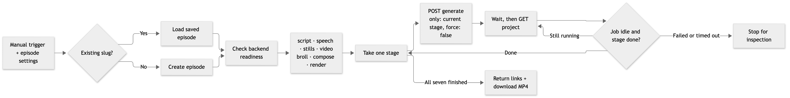
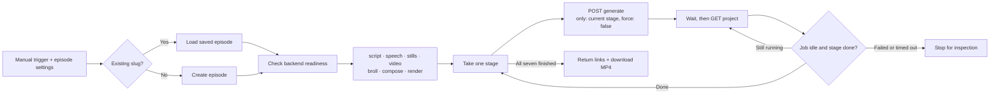

# Run the Podframes pipeline from n8n

Import [podframes-seven-stages.json](../examples/n8n/podframes-seven-stages.json) into n8n. It mirrors the **seven backend stages**, in the same order, using one shared stage loop:



This PNG is a rendered diagram preview, not a screenshot of a live n8n execution.

<details>
<summary>Editable Mermaid diagram</summary>



</details>

This is an **API orchestration mirror**, not a standalone reimplementation of Codex, Fish, Whisper, HyperFrames, or the Studio editor. The existing backend still performs the technical work and owns caches, project locks, validation, credentials, billing, and files. It preserves the actual generation implementation rather than approximating it with different n8n AI nodes.

## Prerequisites

1. Finish the [Ubuntu/macOS setup](SETUP.md), including provider logins and a configured owner token.
2. Keep both Podframes web and worker running on the same backend machine.
3. Have an n8n instance supporting Code v2, HTTP Request v4.2, If v2.2, Loop Over Items v3, and Wait v1.1. These are built-in nodes; no community nodes or Execute Command access are needed.
4. Run `pnpm podframes doctor` on the backend before the first episode. The workflow also checks health before enqueueing stages, but health cannot prove every provider's generation permission, available credits, or API-mode HeyGen key.

For installing n8n itself, use its [official hosting documentation](https://docs.n8n.io/hosting/). This repository does not install or expose n8n automatically.

### Connect n8n to the backend

`baseUrl` is resolved by the **n8n server**, not your browser:

| n8n location | Connection |
| --- | --- |
| Native process on the same Ubuntu/Mac host | `http://127.0.0.1:3000` works with the supplied Podframes launcher. |
| Another machine with SSH access | Establish a persistent SSH tunnel from the n8n machine to the backend, then use its local forwarded port. |
| Docker container | Container localhost is not host localhost. Provide a verified route/tunnel from inside the container. Host networking on Linux is one option; a bridge container cannot reach a host service bound only to loopback just by using the host's IP. |
| n8n Cloud | Needs a reachable authenticated HTTPS endpoint. The private SSH-only setup is not directly reachable from n8n Cloud. Configure that endpoint separately. |

For native n8n on another machine, run this on the **n8n machine** and keep it connected:

```sh
ssh -N -L 3000:127.0.0.1:3000 your-user@BACKEND_IP
```

Use `http://127.0.0.1:3000` in the workflow. If that local port is taken, choose another local port and update `baseUrl`. Keep the backend private unless you deliberately configure HTTPS and owner authentication. Do not change its bind address merely to make a container connection work without considering who can reach it.

## Import and configure

1. Download the [workflow JSON](../examples/n8n/podframes-seven-stages.json).
2. In n8n's workflow menu, choose **Import from File**. The imported workflow is inactive and starts with a Manual Trigger. See [n8n import instructions](https://docs.n8n.io/workflows/export-import/).
3. Create an **HTTP Header Auth** credential:
   - Name: a neutral label such as `Podframes owner`.
   - Header name: `Authorization`.
   - Header value: `Bearer YOUR_OWNER_TOKEN`, using `PODFRAMES_API_TOKEN` from backend `.env.local`.
4. Select that credential in **all six HTTP Request nodes**: Load episode, Create episode, Check backend, Enqueue stage, Read project status, Download MP4. No token is included in the JSON. Keep it in n8n's credential store, not in node parameters or code.
5. Open **Episode settings**, then edit the non-secret JavaScript object:

   ```js
   baseUrl: 'http://127.0.0.1:3000',
   existingSlug: '',
   operationId: 'podframes-n8n-' + $execution.id,
   pollSeconds: 70,
   maxStageMinutes: 120,
   ```

6. For a new episode, edit `config.topic`, `language`, `targetDurationSec`, `aspectRatio`, hosts, and `config.options.videoProvider`. The supplied voices match Podframes' default two-host cast. API validation remains authoritative.
7. For a saved episode, set `existingSlug` instead. Its saved config, portraits, dialogue, options, and media remain authoritative; the sample `config` is not patched onto it. You can prepare an imported script or a template-based episode in Studio first, then use its slug here.
8. Save. Execute the full workflow only when you intend to use provider credits.

For `videoProvider`, use `replicate-p-video`, `fal-ltx`, or `heygen`. HeyGen's `heygenAuth` is `subscription` or `api`. Keys and sessions belong on the backend, never in this workflow. Selectable writers and other options use the same [API contract](API.md) as Studio.

## What each stage does

| Stage item | API request body | Backend work |
| --- | --- | --- |
| `script` | `{ "slug": "…", "only": ["script"], "force": false }` | Research and draft structured dialogue, or reuse the saved script. |
| `speech` | Same shape with `speech` | Fish MCP speech, local Whisper timing, audio assembly. |
| `stills` | Same shape with `stills` | Reuse or generate host portraits. |
| `video` | Same shape with `video` | Selected provider animates portraits with real speech segments. |
| `broll` | Same shape with `broll` | Plan and produce supporting visuals under the saved settings. |
| `compose` | Same shape with `compose` | Build the timed HTML composition, captions, and linked media. |
| `render` | Same shape with `render` | HyperFrames capture and ffmpeg export. |

All use `POST /api/v1/generate`. Loop Over Items has batch size **1**. The workflow does not start another stage while the current project's queue job remains active, even if the stage already says `done`. This avoids racing a new enqueue against the previous job's final persistence.

Each iteration waits, reads `GET /api/v1/projects/{slug}`, and requires both `runActive: false` and `stages[currentStage]: "done"` before advancing. An idle job with an unfinished/error stage stops the workflow. Invalid status responses and polling timeouts also stop it. It does not hold an HTTP request open for the whole render or consume the SSE stream.

The final **Episode ready** output contains the slug, seven stage results, Studio link, and authenticated API download URL. **Download MP4** retrieves the finished video into n8n binary property **`video`**. The download URL itself does not grant public access; requests still need the owner credential. Avoid making large videos part of long-lived execution histories if you only need the link: you can disable the final download node.

### Differences from a single full-pipeline request

- This mirror submits **seven generation POST operations per execution**, even when some stages reuse completed artifacts. They count toward the backend's daily HTTP generation budget. Other generation actions consume the same budget; adjust it intentionally if necessary.
- Each backend job checks its selected stage's prerequisites. The usual all-stage preflight is not performed as one transaction before the first stage. Run doctor first and keep the workflow's health gate enabled.
- There is one n8n stage-loop node, not seven copied copies of the enqueue/poll logic. The seven named items remain visible in the execution data.
- Studio's face editing, script importing, cue editing, trimming, and preview controls remain in Studio. This workflow runs saved episode settings and generation stages; it does not reproduce that UI.

## Retries, recovery, and paid requests

Every POST has an `Idempotency-Key` derived from `operationId`: `…-create`, `…-script`, through `…-render`. The prefix must have 16–100 letters, digits, dots, underscores, or hyphens. The default n8n execution ID gives each fresh execution a new operation prefix. Automatic HTTP retries are disabled.

**Re-executing the workflow with a blank `existingSlug` starts a new episode** under the default settings. To resume without creating another episode:

1. Inspect the failed execution, Studio, and provider jobs. Record the slug from Create episode, Prepare episode, or Begin stage.
2. Let an active backend job finish, or cancel it deliberately in Studio. Stopping/timing out n8n does not cancel the backend job or refund charges.
3. Resolve errors. Interrupted or failed paid jobs may require explicit acknowledgement in Studio after checking provider state. The workflow never sends `force: true` or `acknowledgeInterrupted: true` automatically.
4. Set `existingSlug` to the saved slug and run again. Ordinary completed stages are reused. A prior queued/active run or a backend review requirement blocks another admission rather than duplicating paid work.

For an exact transport retry of a POST whose response was lost, reuse its exact operation prefix and body. Completed receipts replay; pending/uncertain receipts can return 409. Changing the body with the same key is an error. Do not keep minting fresh keys to bypass an uncertain purchase. See [API idempotency and recovery](API.md).

The default Wait interval is 70 seconds. n8n documents that short waits below 65 seconds remain in memory rather than offloading execution data; see [Wait behavior](https://docs.n8n.io/integrations/builtin/core-nodes/n8n-nodes-base.wait/). You can reduce the interval for faster local feedback, but the backend queue and artifacts—not a live n8n process—remain the recovery source of truth.

Each stage has a two-hour polling limit by default, and the workflow has a 24-hour execution timeout. Your n8n instance/plan may impose a lower limit. A polling timeout leaves the remote job alone; inspect it before starting a new run.

## Scheduling and extensions

Start with the Manual Trigger. Once a paid short episode has been reviewed, you can replace it with n8n's Schedule Trigger or call it from another workflow. Each scheduled occurrence should supply its own topic and deliberate operation identity. Do not schedule repeated generation against a blank slug and unchanged topic unless you intend to create multiple episodes.

You can connect storage or review nodes after Download MP4 using its `video` binary property. No publishing, messaging, or uploading is configured by this template.

## Verification and current limits

Run the included checks without contacting providers:

```sh
node --test examples/n8n/podframes-seven-stages.test.mjs
```

They execute the embedded JavaScript against mocked n8n inputs and backend responses: matching core stage order, readiness failures, saved configuration, active-job polling, successful completion, errors, timeout, credential-free export, and safe download URL construction. These checks do not prove n8n runtime import/execution compatibility. The workflow has not yet been imported into a live n8n instance or used for a paid end-to-end episode; verify that in your instance before scheduling it.
